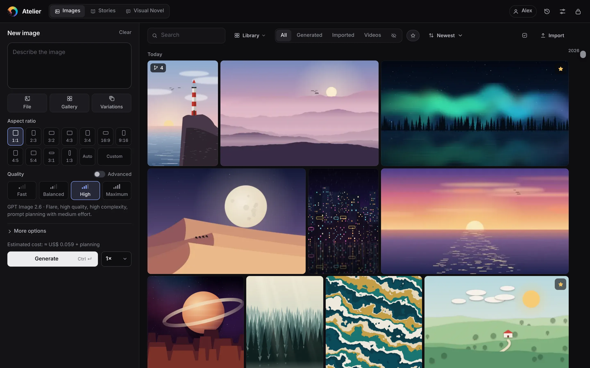
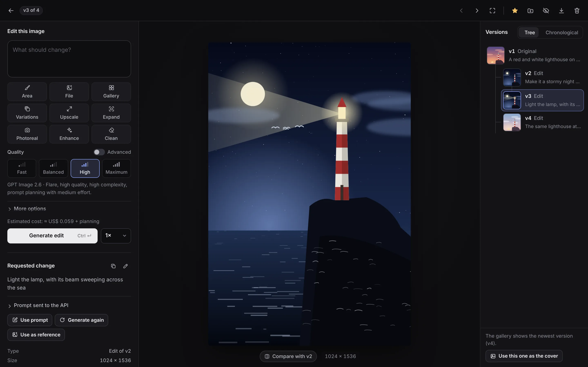
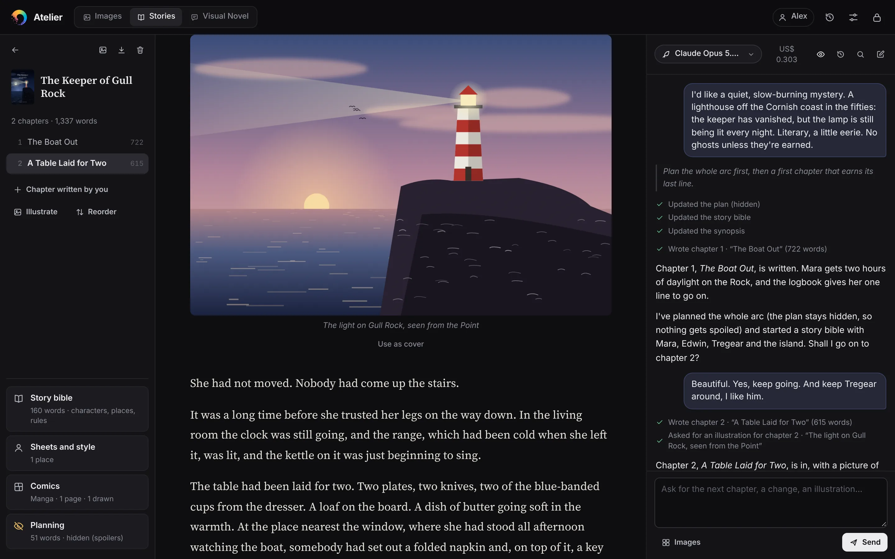
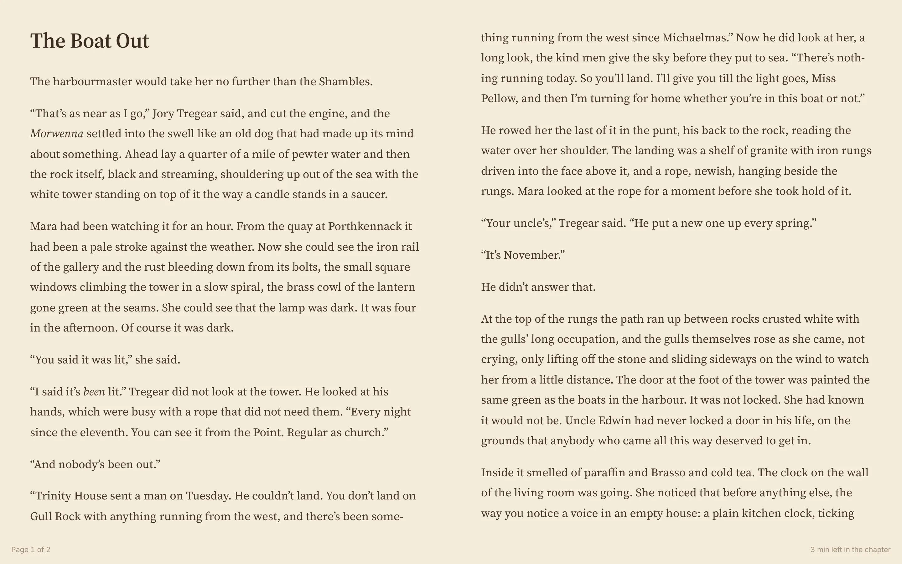
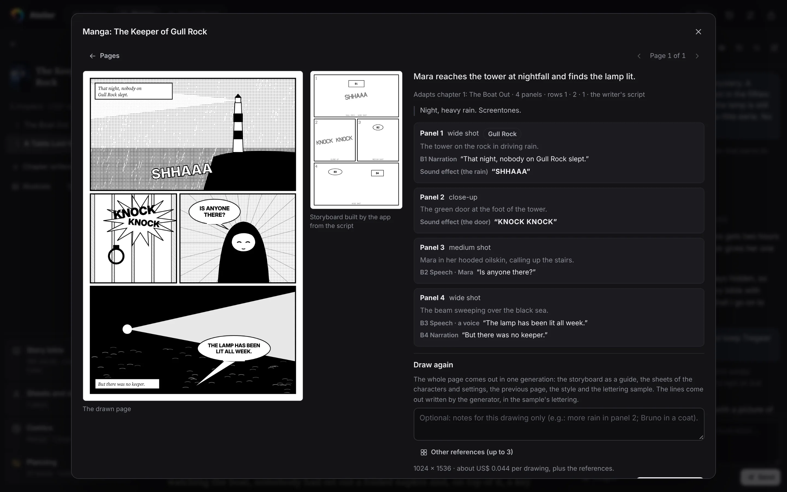

  

<h1 align="center">Atelier</h1>

  A private studio for pictures and stories made with AI, on your own server. 
  <a href="README.pt-BR.md">Leia em português</a>

Atelier is a small web app you put on any PHP host and keep for yourself. You bring your own API keys, and everything you make stays with you: the pictures, the prompts and the stories, all encrypted with your password.

It began as a tidy place for image generations and slowly turned into a workshop. There's a gallery that remembers every version of every picture, a writer that plans and writes whole books with you, a proper reader for them, and comics and visual novels made from the same stories.

## Pictures

Describe what you want, pick a shape and a quality, and generate. Atelier works with OpenAI's GPT Image models and, if you add a Google key, with Nano Banana.

- **Edit by describing.** Say what should change, paint over the part you mean, or bring in other pictures from your library as references (`@1`, `@2`).
- **One-click helpers.** Upscale, expand the canvas, make it photoreal, enhance it, or clean up noise and stray lines.
- **Nothing gets lost.** Every edit becomes a new version in a tree. Go back, compare with the original, or branch off in another direction.
- **A library you can find things in.** Albums, favourites, stacks, hidden pictures, search by prompt, sort by size or shape. Videos too: drop in a clip, pick a frame and edit it.

## Stories

Start a story by telling the writer what you'd like to read. The writer is Claude, GPT or Gemini, whichever you prefer, and you can switch in the middle of a conversation.

- **It plans before it writes.** The whole arc goes into a hidden plan, so the twists stay twists, and a story bible keeps track of people, places and rules.
- **Chapter by chapter, at your pace.** Ask for the next chapter, a rewrite, a different ending or a small fix to one line. Or write a chapter yourself.
- **It illustrates as it goes.** Pictures inside the chapters, covers in a few styles to choose from, and character and place sheets so faces stay the same from one chapter to the next.
- **It gets to know you.** Tell it once what you enjoy as a reader, and it keeps notes on what it notices.

When it's time to read, open the reader: pages or scroll, dark, black, sepia or light, the type and size you like, and it remembers where you stopped. Any story can also be downloaded as an EPUB.

## Comics, manga and visual novels

The same story can become something else.

- **Comics and manga.** The writer adapts chapters into pages: a script for every panel, a storyboard, a lettering sample, and then the drawn page. Download the result as PDF or CBZ.
- **Visual novels.** Scenes with choices, variables and several endings, with sprites, backgrounds and CGs. Play it right in the browser, then export a Ren'Py project ready to run.

## And also

- **Claude can use it too.** A built-in MCP server lets Claude, or any MCP client, make pictures and work on your stories with the same tools the app's writer has.
- **Private by design.** Each account's library is encrypted with a key that only its password opens, so not even the admin can look inside. No analytics, no trackers, no outside fonts. The only calls that leave your server go to the AI providers you chose.
- **Room for a few people.** One install can hold several accounts, each with its own library and keys.
- **Knows what things cost.** An estimate before you generate, the real cost afterwards, and, if you like, a running balance for each provider.
- **In English and Brazilian Portuguese.**

## Getting started

You need a web host with PHP 8.2 or newer and HTTPS. There's no database server to set up, no Composer and no build step: it's PHP, SQLite and plain JavaScript.

1. Upload the app to your site, copy `config.example.php` to `config.php` and set a long random `setup_token`.
2. Open the site, enter that token and create the first account.
3. In **Settings › API keys**, add your OpenAI key. Claude and Gemini keys are optional; they power the writer.

[docs/install.md](docs/install.md) has the rest: requirements, web server settings, long requests, MCP, moving, backups and tests.

## About the screenshots

Everything in them was made for this page. The pictures are simple illustrations drawn in code, standing in for what your models will make, and *The Keeper of Gull Rock* is a short original story written for the demo.

## License

[MIT](LICENSE)
