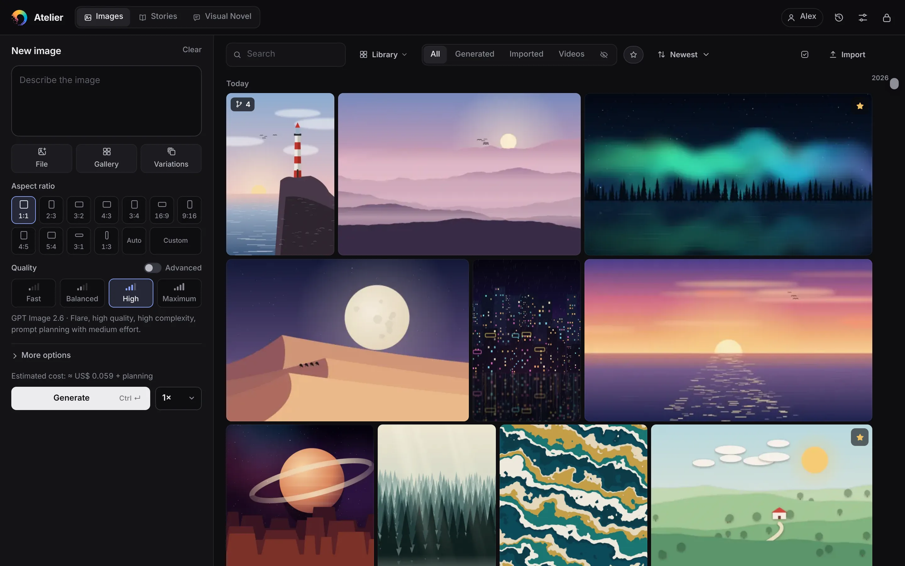
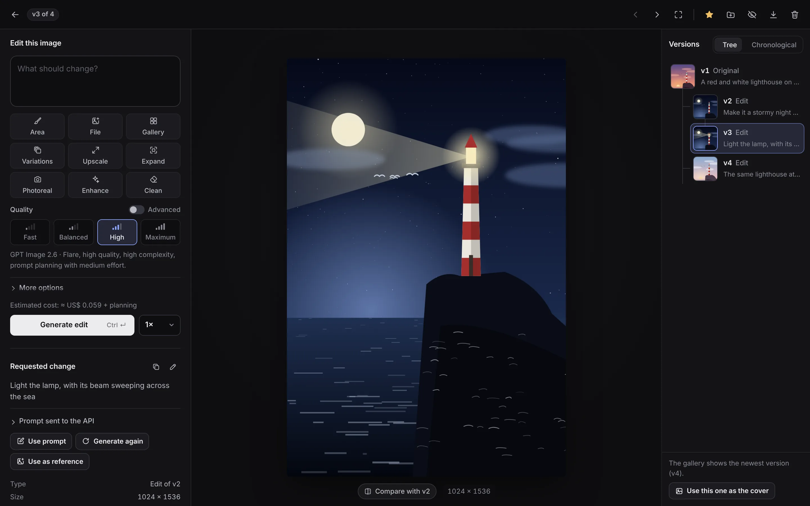
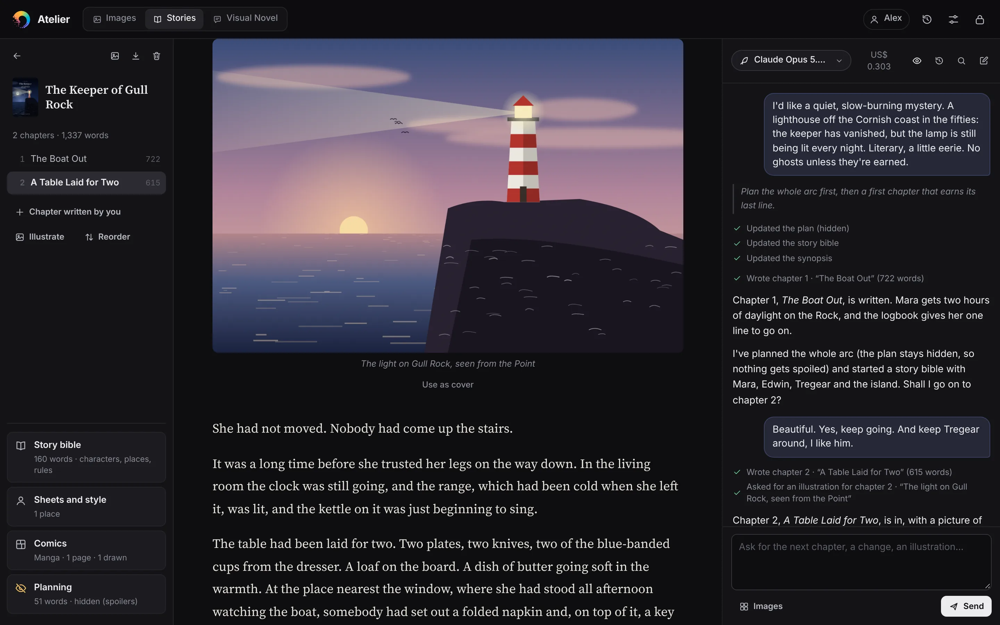
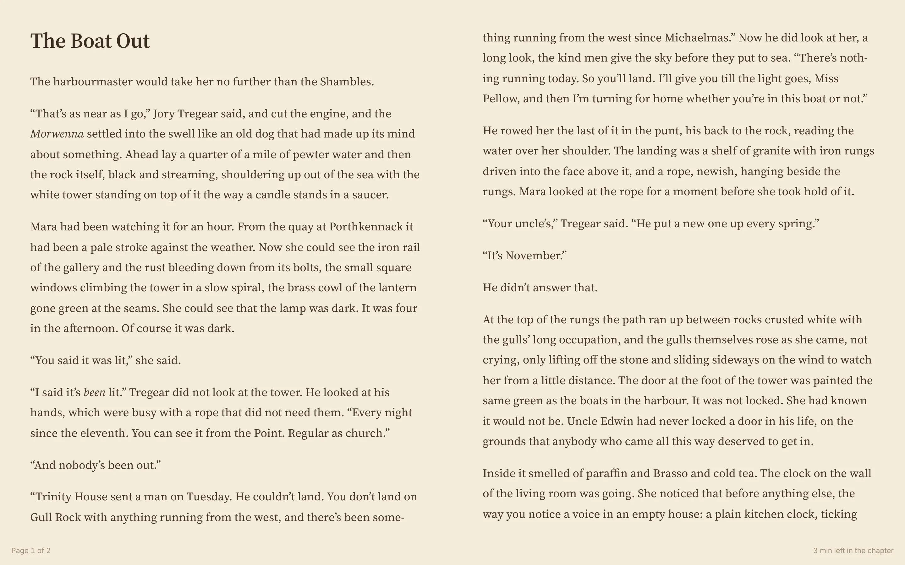
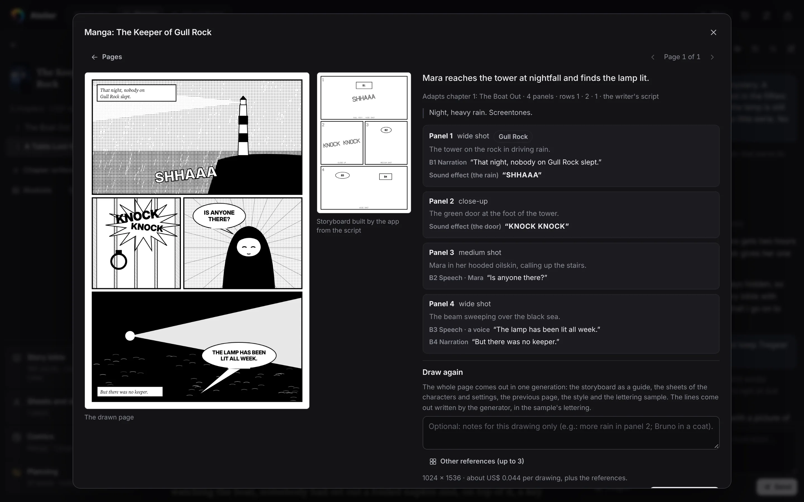

  

<h1 align="center">Atelier</h1>

  Um estúdio particular para imagens e histórias feitas com IA, no seu próprio servidor. 
  <a href="README.md">Read in English</a>

O Atelier é um aplicativo web pequeno, que você instala em qualquer hospedagem com PHP e guarda só para você. Você usa as suas próprias chaves de API, e tudo o que fizer fica com você: as imagens, os prompts e as histórias, tudo criptografado com a sua senha.

Ele começou como um lugar arrumado para guardar imagens geradas e, aos poucos, virou uma oficina. Tem uma galeria que lembra cada versão de cada imagem, um escritor que planeja e escreve livros inteiros com você, um leitor de verdade para lê-los, e quadrinhos e visual novels feitos a partir das mesmas histórias.

## Imagens

Descreva o que você quer, escolha o formato e a qualidade, e gere. O Atelier trabalha com os modelos GPT Image da OpenAI e, se você puser uma chave do Google, com o Nano Banana.

- **Edite descrevendo.** Diga o que deve mudar, pinte a parte que você quer mexer, ou traga outras imagens da biblioteca como referência (`@1`, `@2`).
- **Ajudas de um clique.** Ampliar, expandir a tela, deixar fotorrealista, melhorar, ou limpar ruídos e linhas soltas.
- **Nada se perde.** Cada edição vira uma versão nova numa árvore. Dá para voltar, comparar com a original ou seguir por outro caminho.
- **Uma biblioteca onde você acha as coisas.** Álbuns, favoritas, pilhas, imagens ocultas, busca pelo prompt, ordem por tamanho ou formato. Vídeos também: solte um clipe, escolha um frame e edite.
- **Vídeos com som, na sua própria GPU.** Comece do texto, fixe imagens no primeiro quadro, no último ou em qualquer segundo no meio, traga imagens, vídeos e sons como referência, ou parta de um vídeo: continue, siga o movimento dele ou troque uma parte. Um ajudante reescreve a sua ideia do jeito que o modelo (MiniMax H3) entende melhor. Roda numa GPU alugada por hora, como a do Google Colab: um notebook lá pega os pedidos, manda os vídeos para a sua biblioteca e desliga sozinho quando você para. Veja [Vídeos na GPU](docs/manual.pt-BR.md#fazer-vídeos-na-gpu-google-colab).

## Histórias

Comece uma história contando ao escritor o que você gostaria de ler. O escritor é o Claude, o GPT ou o Gemini, o que você preferir, e dá para trocar no meio da conversa.

- **Ele planeja antes de escrever.** O arco inteiro vai para um planejamento escondido, para as surpresas continuarem surpresas, e uma bíblia da história guarda as pessoas, os lugares e as regras.
- **Capítulo por capítulo, no seu ritmo.** Peça o próximo capítulo, uma reescrita, outro final ou um ajuste numa frase. Ou escreva você mesmo um capítulo.
- **Ele ilustra enquanto escreve.** Imagens dentro dos capítulos, capas em alguns estilos para você escolher, e fichas de personagens e lugares para os rostos continuarem os mesmos de um capítulo para o outro.
- **Ele vai conhecendo você.** Conte uma vez do que você gosta como leitor, e ele anota o que vai percebendo.

Na hora de ler, abra o leitor: páginas ou rolagem, fundo escuro, preto, sépia ou claro, a letra e o tamanho que você gosta, e ele lembra onde você parou. Toda história também pode ser baixada em EPUB.

## Quadrinhos, mangá e visual novel

A mesma história pode virar outra coisa.

- **Quadrinhos e mangá.** O escritor adapta os capítulos em páginas: um roteiro para cada quadro, um esboço, uma amostra das letras e, por fim, a página desenhada. O resultado sai em PDF ou CBZ.
- **Visual novel.** Cenas com escolhas, variáveis e vários finais, com sprites, cenários e CGs. Jogue no próprio navegador e depois exporte um projeto do Ren'Py pronto para rodar.

## E mais

- **O Claude também pode usar.** Um servidor MCP embutido deixa o Claude, ou qualquer cliente MCP, criar imagens e trabalhar nas suas histórias com as mesmas ferramentas do escritor do app.
- **Privado desde o começo.** A biblioteca de cada conta é criptografada com uma chave que só a senha dela abre, então nem o administrador consegue olhar dentro. Sem analytics, sem rastreadores, sem fontes de fora. As únicas chamadas que saem do seu servidor vão para os provedores de IA que você escolheu.
- **Cabem algumas pessoas.** Uma instalação pode ter várias contas, cada uma com a sua biblioteca e as suas chaves.
- **Sabe quanto as coisas custam.** Uma estimativa antes de gerar, o custo real depois e, se quiser, o saldo de cada provedor sendo descontado.
- **Em português do Brasil e em inglês.**

## Para começar

Você precisa de uma hospedagem com PHP 8.2 ou mais novo e HTTPS. Não tem banco de dados para configurar, nem Composer, nem etapa de build: é PHP, SQLite e JavaScript puro.

1. Baixe o zip da [versão mais recente](https://github.com/JohanKRS/atelier/releases/latest) e envie o que está dentro dele para o seu site. Copie `config.example.php` para `config.php` e defina um `setup_token` longo e aleatório.
2. Abra o site, informe esse código e crie a primeira conta.
3. Em **Configurações › Chaves de API**, cadastre a sua chave da OpenAI. As chaves do Claude e do Gemini são opcionais e servem ao escritor.

O resto está em [docs/install.md](docs/install.md) (em inglês) e, com todos os detalhes de cada parte, no [manual completo em português](docs/manual.pt-BR.md).

## Sobre as imagens desta página

Tudo nelas foi feito para esta página. As imagens são ilustrações simples desenhadas em código, no lugar do que os seus modelos vão criar, e *The Keeper of Gull Rock* é um conto original escrito para a demonstração.

## Licença

[MIT](LICENSE)
